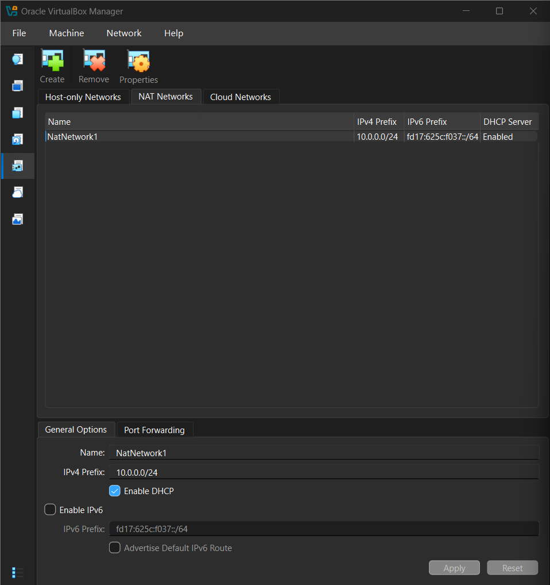
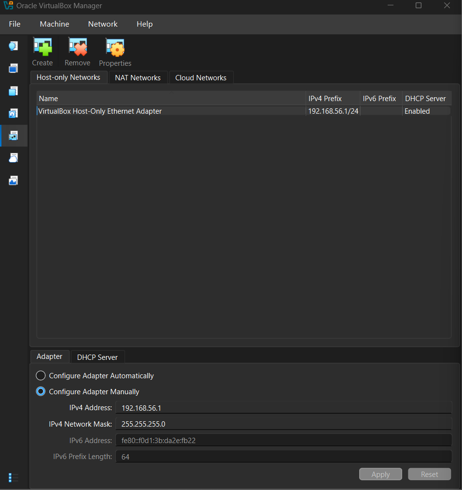
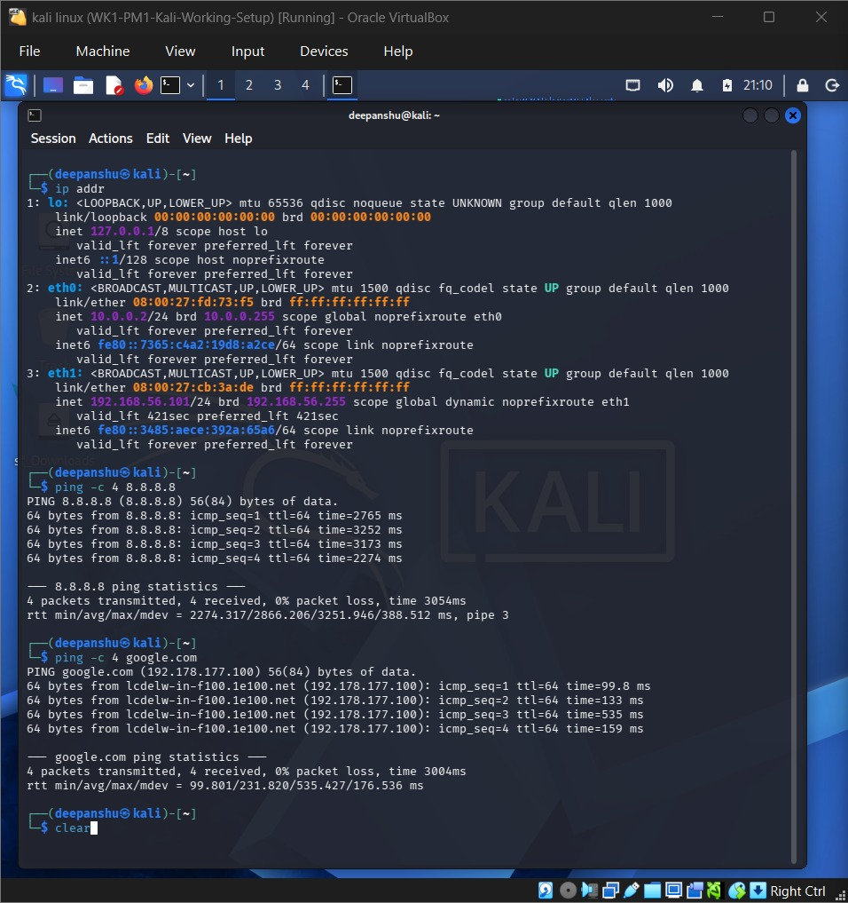
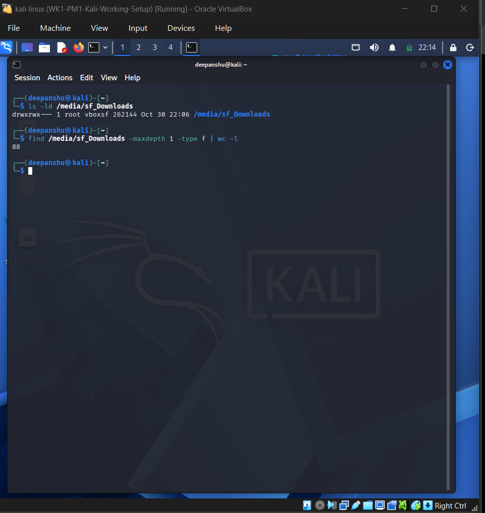
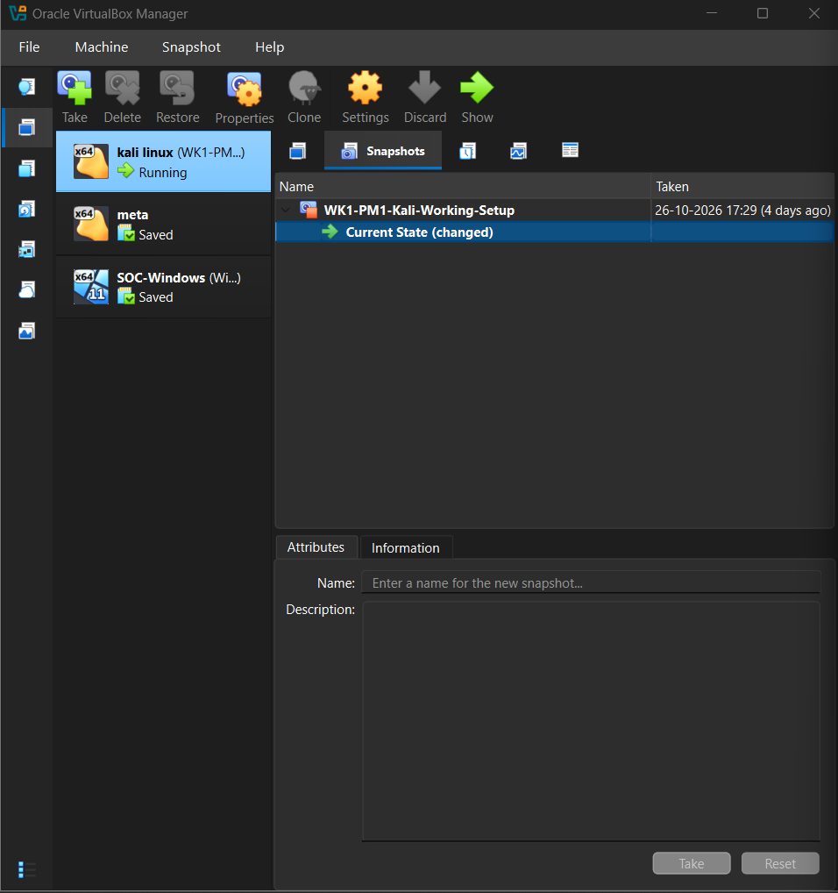

# VirtualBox Kali Linux Cybersecurity Lab

## 1. Project Overview

This project documents the setup and configuration of a cybersecurity testing lab using Oracle VirtualBox and Kali Linux.

The purpose of this lab is to establish a virtual testing environment for learning cybersecurity fundamentals, network configuration, and ethical hacking practices.

## 2. Lab Objectives

- Install and configure Oracle VirtualBox.
- Create a custom NAT Network.
- Configure Kali Linux as an attacking machine.
- Assign a static IP address to Kali Linux.
- Enable clipboard sharing and drag-and-drop.
- Configure shared folders between host and virtual machine.
- Establish and verify internet connectivity.
- Create a virtual machine snapshot.

## 3. Lab Environment

| Component | Configuration |
|---|---|
| Host OS | Windows 11 |
| Virtualization Software | Oracle VirtualBox |
| Virtual Machine | Kali Linux |
| Network Mode | NAT Network |
| Network Subnet | 10.0.0.0/24 |
| Kali Linux IP | 10.0.0.2/24 |
| Shared Folder | Downloads |
| Internet Access | Configured |

## 4. Tasks Performed

1. Installed 7-Zip.
2. Installed Oracle VirtualBox.
3. Created a custom NAT Network.
4. Downloaded and imported Kali Linux.
5. Configured Kali Linux IP addressing.
6. Enabled clipboard and drag-and-drop.
7. Configured host-to-guest shared folders.
8. Verified internet connectivity.
9. Created a VM snapshot.

## 5. Repository Structure

- `docs/` – Detailed setup documentation.
- `screenshots/` – Lab configuration screenshots.
- `troubleshooting/` – Troubleshooting notes.
- `README.md` – Project overview.

## 6. Learning Outcomes

- Virtualization and virtual machine management.
- Basic networking and IP addressing.
- NAT Network configuration.
- Kali Linux environment setup.
- Shared folder configuration.
- Network connectivity troubleshooting.

## 7. Acknowledgement

Learning resources and lab instructions: Networkwalks Academy.

## 8. Disclaimer

This lab is intended for educational purposes and authorized cybersecurity testing only.
## Lab Screenshots

### 1. NAT Network Configuration

### 2. Host-Only Network Configuration

### 3. Kali Linux IP and Internet Verification

### 4. Shared Folder Verification

### 5. Kali Linux VM Snapshot

